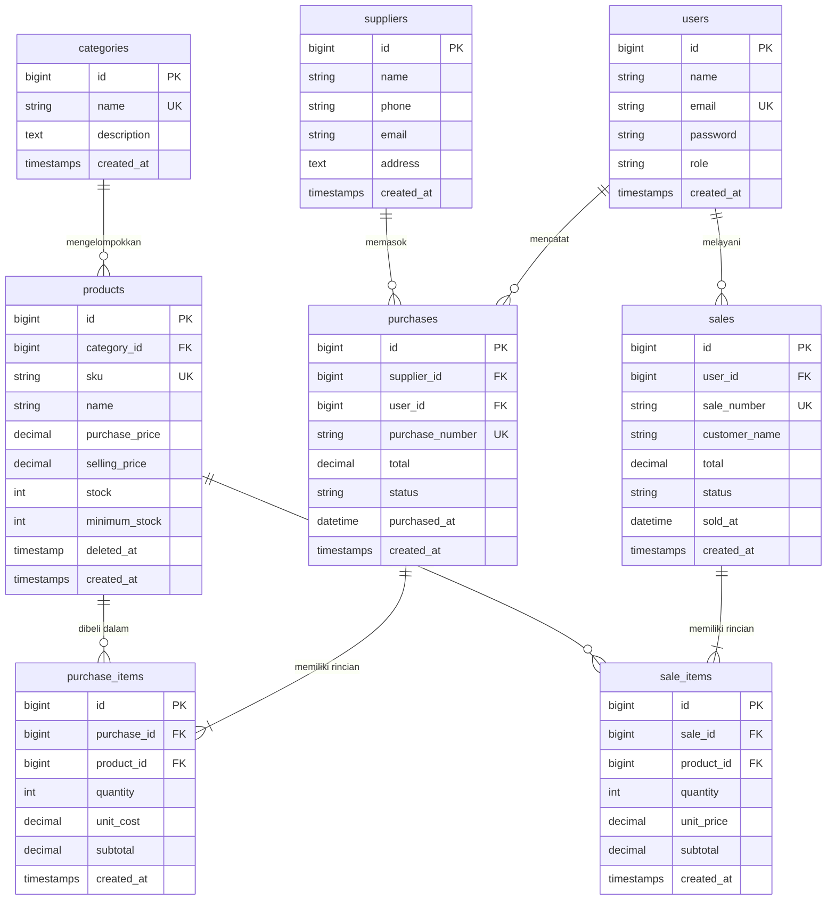

# Inventory & Sales Management System (UTS Pemrograman Web 2)

Sistem Manajemen Inventaris dan Penjualan Terintegrasi berbasis **Laravel 12** dan **MySQL / MariaDB**. Aplikasi ini dibangun untuk memenuhi seluruh kriteria dan rubrik penilaian Ujian Tengah Semester (UTS) mata kuliah Pemrograman Web 2 / Web Programming.

---

## 1. Project Overview & Latar Belakang Bisnis

Pada usaha distribusi dan retail skala kecil-menengah, pencatatan manual sering menghadapi berbagai permasalahan serius:
- Ketidakkonsistenan antara stok fisik di gudang dengan catatan transaksi.
- Risiko *overselling* (produk habis tetapi masih bisa terjual ke pelanggan).
- Kesulitan menelusuri riwayat keluar-masuk barang secara akurat.
- Ketiadaan kontrol hak akses berjenjang antara pemilik (*Admin/Owner*) dan staf operasional (*Staff*).
- Kurangnya visibilitas metrik omset dan peringatan stok menipis secara *real-time*.

Aplikasi ini mengatasi seluruh masalah tersebut dengan menerapkan integritas data tingkat database, transaksi atomik (`DB::transaction`), penguncian baris (`lockForUpdate`), kalkulasi harga di sisi server (*server-side calculation*), serta kontrol hak akses di tingkat server (*server-side authorization*).

---

## 2. Requirements & Kebutuhan Lingkungan

- **Sistem Operasi:** Windows, Linux, atau macOS
- **PHP:** Versi 8.2 atau lebih baru (ekstensi: `pdo_mysql`, `mbstring`, `openssl`, `tokenizer`, `xml`, `fileinfo`)
- **Database:** MySQL 8.x atau MariaDB 10.4+ (misalnya dari paket XAMPP)
- **Dependency Manager:** Composer 2.x
- **Web Server:** PHP Built-in Server (`php artisan serve`) atau Apache XAMPP
- **Browser:** Google Chrome, Mozilla Firefox, atau Microsoft Edge modern

---

## 3. Langkah Instalasi Reproducible (Cara Menjalankan Proyek)

Ikuti langkah-langkah praktis berikut untuk menjalankan proyek di komputer dosen atau komputer penguji:

```bash
# 1. Clone repository ke komputer lokal
git clone <URL_REPOSITORY_ANDA>
cd inventory-sales

# 2. Pasang dependensi PHP melalui Composer
composer install

# 3. Gandakan file template konfigurasi environment
cp .env.example .env

# 4. Generate application encryption key
php artisan key:generate

# 5. Konfigurasikan kredensial database pada file .env:
#    Pastikan database 'inventory_sales_uts' telah dibuat di MySQL/XAMPP.
#    DB_CONNECTION=mysql
#    DB_HOST=127.0.0.1
#    DB_PORT=3306
#    DB_DATABASE=inventory_sales_uts
#    DB_USERNAME=root
#    DB_PASSWORD=

# 6. Jalankan migrasi dan seeder data awal otomatis
php artisan migrate --seed

# 7. Jalankan development server
php artisan serve
```

Aplikasi siap diakses melalui web browser pada alamat: **`http://127.0.0.1:8000`**

---

## 4. Akun Demo untuk Pengujian & Demo Dosen

Database seeder telah menyiapkan 2 akun dengan hak akses berbeda yang siap diuji:

| Role / Jabatan | Alamat Email | Kata Sandi | Lingkup Hak Akses |
| :--- | :--- | :--- | :--- |
| **Admin / Owner** | `admin@inventory.test` | `password` | **Akses Penuh:** CRUD kategori, produk, supplier, kelola akun pengguna/role, lihat semua transaksi & laporan, batalkan transaksi dengan pemulihan stok. |
| **Staff Gudang** | `staff@inventory.test` | `password` | **Akses Operasional:** Lihat katalog produk & stok, catat pembelian (stok masuk), catat penjualan (kasir/stok keluar), lihat struk. Tidak dapat menghapus master data atau mengelola akun pengguna. |

> **Tips Cepat:** Pada halaman login, tersedia tombol pintas (*quick-fill*) **"Admin / Owner"** dan **"Staff Gudang"** untuk mengisi email dan kata sandi secara instan tanpa perlu mengetik manual.

---

## 5. Fitur Utama & Hak Akses Berjenjang

### A. Autentikasi & Otorisasi Server-Side
- Login dan logout berbasis session Laravel dengan proteksi *session fixation* (`regenerate()`) dan CSRF token.
- Password dienkripsi dengan standar algoritma **BCRYPT**.
- Perlindungan hak akses diterapkan di sisi server melalui `RoleMiddleware` (`role:admin`). Upaya akses langsung via URL browser oleh Staff ke endpoint terlarang akan langsung diblokir dengan kode respon **HTTP 403 Forbidden**.

### B. Master Data (Kategori, Produk, Supplier)
- **Kategori:** Manajemen nama kategori unik dengan deskripsi. Kategori yang masih menampung produk dilindungi dari penghapusan (*relational protection*).
- **Supplier:** Informasi nama pemasok, kontak telepon, email, dan alamat fisik.
- **Produk:** Dilengkapi SKU unik, nama, kategori, harga beli, harga jual, stok fisik, dan batas minimum stok. Produk yang telah memiliki riwayat transaksi dilindungi dari penghapusan permanen menggunakan **Soft Deletes**.

### C. Transaksi Pembelian (Stock-In)
- Multi-item dynamic input: Staff dapat menambahkan banyak jenis barang sekaligus dalam satu surat pemesanan (PO).
- Stok barang bertambah otomatis secara instan setelah transaksi berhasil.
- Pembatalan transaksi pembelian (khusus Admin) akan menarik/mengurangi kembali stok, didukung validasi bahwa stok sisa tidak menjadi negatif akibat penjualan terdahulu.

### D. Transaksi Penjualan (Stock-Out / Kasir)
- Multi-item dynamic cart: Pemilihan produk dengan informasi stok *real-time*.
- Validasi ketat batas stok: Kuantitas penjualan yang melebihi sisa stok di database akan **ditolak seketika**.
- Harga jual diambil langsung dari data server, bukan mempercayai input form peramban.
- Pembatalan penjualan (khusus Admin) akan mengembalikan (*restore/increment*) stok barang secara konsisten.

### E. Dashboard & Usability
- Agregat kalkulasi langsung dari database (bukan nilai statis): total produk, total unit stok, omset hari ini, omset bulan ini, dan total transaksi.
- Tabel pemantauan **Stok Kritis / Menipis** (`stock <= minimum_stock`) dengan indikator peringatan visual berwarna merah.
- Pencarian multi-kriteria (SKU, nama produk, nomor transaksi, nama pelanggan), filter rentang tanggal, filter status, dan penomoran halaman (*pagination*) yang mempertahankan parameter pencarian (`withQueryString()`).
- Tata letak responsif menggunakan Tailwind CSS dan siap cetak (*print-friendly receipt*).

---

## 6. Diagram ERD & Relasi Database

### A. Diagram Hubungan Entitas (Mermaid ERD)



### B. Penjelasan Relasi Eloquent Antar Model

1. **`Category` dan `Product` (`One-to-Many`)**
   - Satu kategori dapat memiliki banyak produk (`Category hasMany Product`).
   - Setiap produk berelasi ke tepat satu kategori (`Product belongsTo Category`).
   - Foreign key: `products.category_id` merujuk ke `categories.id`.
2. **`Supplier` dan `Purchase` (`One-to-Many`)**
   - Satu pemasok dapat memiliki banyak riwayat transaksi pembelian (`Supplier hasMany Purchase`).
   - Setiap pembelian berasal dari satu supplier (`Purchase belongsTo Supplier`).
   - Foreign key: `purchases.supplier_id` merujuk ke `suppliers.id`.
3. **`Purchase` dan `PurchaseItem` (`One-to-Many`)**
   - Satu transaksi pembelian menampung satu atau lebih item barang (`Purchase hasMany PurchaseItem`).
   - Setiap item pembelian terikat pada nota pembelian induknya (`PurchaseItem belongsTo Purchase`).
   - Foreign key: `purchase_items.purchase_id` dengan aksi *cascade on delete*.
4. **`Product` dan `PurchaseItem` (`One-to-Many`)**
   - Suatu produk dapat tercatat di banyak item pembelian (`Product hasMany PurchaseItem`).
   - Item pembelian merujuk ke data master produk (`PurchaseItem belongsTo Product`).
   - Foreign key: `purchase_items.product_id` dengan perlindungan `restrictOnDelete`.
5. **`Sale` dan `SaleItem` (`One-to-Many`)**
   - Satu struk penjualan menampung banyak item produk yang dibeli (`Sale hasMany SaleItem`).
   - Setiap item penjualan terikat pada nota penjualan induk (`SaleItem belongsTo Sale`).
   - Foreign key: `sale_items.sale_id` dengan *cascade on delete*.
6. **`Product` dan `SaleItem` (`One-to-Many`)**
   - Suatu produk dapat terjual berkali-kali di berbagai transaksi penjualan (`Product hasMany SaleItem`).
   - Item penjualan merujuk ke data master produk (`SaleItem belongsTo Product`).
   - Foreign key: `sale_items.product_id` dengan perlindungan `restrictOnDelete`.
7. **`User` ke `Purchase` dan `Sale` (`One-to-Many`)**
   - Satu pengguna (staf/admin) dapat mencatat banyak pembelian dan melayani banyak penjualan (`User hasMany Purchases`, `User hasMany Sales`).
   - Setiap transaksi mencatat `user_id` pembuat untuk keperluan audit trail.

---

## 7. Bukti Pengujian Otomatis (Automated Testing)

Proyek ini telah dilengkapi dengan rangkaian pengujian otomatis (*Automated Feature Tests*) menggunakan **PHPUnit** pada berkas [`tests/Feature/InventorySalesTest.php`](file:///c:/Users/MSI-16R/UTS-Inventory-Laravel/inventory-sales/tests/Feature/InventorySalesTest.php). Pengujian mencakup seluruh skenario wajib pada Slide 19 petunjuk UTS.

Untuk menjalankan pengujian secara mandiri, ketikkan perintah:

```bash
php artisan test
```

### Hasil Eksekusi Uji:
```text
   PASS  Tests\Unit\ExampleTest
  ✓ that true is true

   PASS  Tests\Feature\ExampleTest
  ✓ the application returns a successful response

   PASS  Tests\Feature\InventorySalesTest
  ✓ guest cannot access dashboard and is redirected to login
  ✓ invalid login credentials are rejected
  ✓ valid login succeeds and redirects to dashboard
  ✓ product duplicate sku is rejected
  ✓ product negative price is rejected
  ✓ purchase successfully increases product stock
  ✓ sale successfully decreases product stock
  ✓ sale with insufficient stock is rejected without data change
  ✓ multi item sale atomic rollback if one item exceeds stock
  ✓ staff cannot access admin functions
  ✓ cancelling sale restores product stock
  ✓ product search and filter

  Tests:    14 passed (43 assertions)
  Duration: 1.09s
```

---

## 8. Panduan Menghadapi Wawancara / Demo Proyek (Code Ownership)

Berikut adalah panduan dan penjelasan teknis mendalam untuk menjawab pertanyaan dosen saat sesi tanya-jawab (*code interview*) sebagaimana tercantum pada Slide 24:

### Pertanyaan 1: Mengapa `Sale` memiliki relasi `hasMany` ke `SaleItem`?
> **Jawaban:** 
> Dalam satu transaksi penjualan di dunia nyata, seorang pelanggan dapat membeli lebih dari satu jenis produk (misalnya: 2 Mouse dan 1 Keyboard). 
> Jika informasi item ditaruh langsung di tabel `sales`, akan terjadi pelanggaran Normalisasi Database (1NF) dan perulangan kolom. Oleh karena itu, dipisahkan menjadi tabel header (`sales`) yang menyimpan data umum (nomor invoice, total, tanggal, kasir) dan tabel detail (`sale_items`) yang berelasi `hasMany` untuk menyimpan kuantitas, harga saat transaksi terjadi, dan subtotal per item.

### Pertanyaan 2: Di mana sistem memastikan stok tidak menjadi negatif?
> **Jawaban:** 
> Sistem memastikannya pada dua lapis:
> 1. **Lapis Validasi Bisnis di Controller ([`SaleController.php`](file:///c:/Users/MSI-16R/UTS-Inventory-Laravel/inventory-sales/app/Http/Controllers/SaleController.php)):** Sebelum melakukan pemotongan stok, sistem memeriksa `$product = Product::lockForUpdate()->findOrFail($productId)` dan menguji kondisi `if ($product->stock < $qty)`. Jika kuantitas yang diminta melebihi stok yang ada, sistem melempar `ValidationException` sehingga proses dibatalkan seketika.
> 2. **Lapis Validasi Input Form (Client-Side & Form Request):** Kuantitas dibatasi bertipe integer dengan nilai minimal 1 (`min:1`).

### Pertanyaan 3: Mengapa total penjualan dihitung di server?
> **Jawaban:** 
> Input dari browser client (seperti HTML form atau JavaScript) sangat rentan dimanipulasi oleh pengguna jahat melalui *Inspect Element* atau alat seperti Postman. Jika harga dan total dipercayai dari input browser, pembeli bisa mengubah harga produk Rp 1.000.000 menjadi Rp 100. 
> Dengan menghitung total di server, sistem mengambil harga resmi `selling_price` langsung dari database dan menghitung `subtotal = $product->selling_price * $qty` secara independen dan terproteksi.

### Pertanyaan 4: Apa risiko jika pengurangan stok dilakukan di luar `DB::transaction`?
> **Jawaban:** 
> Risikonya adalah **hilangnya atomisitas (Data Inconsistency / Partial Failure)**. 
> Misalkan pelanggan membeli 3 barang. Jika barang ke-1 dan ke-2 berhasil mengurangi stok, namun saat memproses barang ke-3 terjadi kegagalan (misalnya database error, server crash, atau stok barang ke-3 habis), maka tanpa `DB::transaction`, stok barang 1 dan 2 sudah terlanjur berkurang padahal transaksi penjualan gagal terbit. 
> Dengan `DB::transaction`, seluruh operasi (pembuatan header, rincian item, dan perubahan stok) menjadi satu kesatuan: jika ada satu saja bagian yang gagal, seluruh perubahan otomatis dibatalkan (*rollback*) ke kondisi semula.

### Pertanyaan 5: Bagaimana mencegah Staff mengakses fungsi Admin melalui URL langsung?
> **Jawaban:** 
> Hanya menyembunyikan tombol di Blade view bukanlah proteksi keamanan. Pencegahan dilakukan di tingkat server menggunakan middleware otorisasi: [`RoleMiddleware.php`](file:///c:/Users/MSI-16R/UTS-Inventory-Laravel/inventory-sales/app/Http/Middleware/RoleMiddleware.php). 
> Pada berkas [`routes/web.php`](file:///c:/Users/MSI-16R/UTS-Inventory-Laravel/inventory-sales/routes/web.php), seluruh rute administratif (manajemen pengguna, CRUD master kategori/produk/supplier, dan pembatalan transaksi) dikelompokkan dalam middleware `role:admin`. Jika Staff mencoba mengetikkan URL seperti `/users` atau `/products-create`, middleware memeriksa `auth()->user()->role === 'admin'`. Karena perannya adalah `staff`, request langsung ditolak dengan status **403 Forbidden**.

### Pertanyaan 6: Apa yang terjadi jika dua penjualan memproses stok produk yang sama hampir bersamaan?
> **Jawaban:** 
> Akan terjadi *race condition* yang memicu *overselling* (misal stok tersisa 1, dua kasir menjual barang tersebut di detik yang sama sehingga stok menjadi -1). 
> Untuk mencegah hal ini, sistem menerapkan teknik **Pessimistic Locking** menggunakan fungsi Eloquent `Product::lockForUpdate()`. Transaksi pertama yang membaca baris produk tersebut akan mengunci baris data di level database MySQL sampai transaksinya selesai dikomit. Transaksi kedua harus menunggu hingga kunci dilepas, lalu membaca stok terbaru yang sudah berkurang, sehingga transaksi kedua akan mendapati stok habis dan ditolak secara aman.

### Pertanyaan 7: Tunjukkan validasi SKU unik dan jelaskan peran constraint database.
> **Jawaban:** 
> - **Validasi di Controller:** Pada `ProductController.php`, digunakan aturan validasi:
>   `'sku' => ['required', 'string', 'max:50', 'unique:products,sku']` (dan saat update: `Rule::unique('products', 'sku')->ignore($product->id)`).
> - **Peran Constraint Database:** Pada berkas migrasi `create_products_table.php`, didefinisikan `$table->string('sku', 50)->unique();`. Constraint database ini adalah benteng pertahanan terakhir (*data integrity guarantee*). Jika terjadi *bypassing* validasi atau request konkuren tinggi, database MySQL itu sendiri yang akan menolak penyimpanan duplikasi SKU dengan memunculkan *unique key integrity violation*.

### Pertanyaan 8: Bagaimana cara mengubah aturan minimum stock dan dampaknya?
> **Jawaban:** 
> Batas minimum stok disimpan pada kolom `minimum_stock` di tabel `products`. 
> Admin dapat mengubahnya kapan saja melalui form edit produk (`/products/{product}/edit`). 
> Dampaknya langsung terlihat di:
> 1. **Katalog Produk:** Jika stok fisik &le; `minimum_stock`, badge status produk akan berubah menjadi merah (*warning badge*).
> 2. **Dashboard:** Produk tersebut otomatis masuk ke dalam tabel peringatan **"Produk Stok Kritis / Menipis"** dan angka statistik peringatan stok akan bertambah secara *real-time*.

---

## 9. Struktur Folder Penting

```text
inventory-sales/
├── app/
│   ├── Http/
│   │   ├── Controllers/
│   │   │   ├── AuthController.php          # Login, logout, proteksi session
│   │   │   ├── CategoryController.php      # CRUD kategori & proteksi relasi
│   │   │   ├── DashboardController.php     # Agregat metrik & alert stok kritis
│   │   │   ├── ProductController.php       # Master produk, SKU unik, soft deletes
│   │   │   ├── PurchaseController.php      # Stock-in atomik & pembatalan
│   │   │   ├── SaleController.php          # Stock-out kasir, lockForUpdate, rollback
│   │   │   ├── SupplierController.php      # Master supplier & kontak
│   │   │   └── UserController.php          # Kelola akun & role (Admin only)
│   │   └── Middleware/
│   │       └── RoleMiddleware.php          # Otorisasi role server-side (403)
│   └── Models/
│       ├── Category.php                    # Relasi hasMany Products
│       ├── Product.php                     # Relasi belongsTo Category, SoftDeletes
│       ├── Purchase.php                    # Relasi Supplier, User, PurchaseItems
│       ├── PurchaseItem.php                # Relasi Purchase & Product
│       ├── Sale.php                        # Relasi User & SaleItems
│       ├── SaleItem.php                    # Relasi Sale & Product
│       ├── Supplier.php                    # Relasi hasMany Purchases
│       └── User.php                        # Role helper (isAdmin, isStaff)
├── database/
│   ├── migrations/                         # 7 file migrasi tabel terintegrasi
│   └── seeders/
│       └── DatabaseSeeder.php              # Akun demo, master kategori, supplier, produk
├── resources/
│   └── views/
│       ├── auth/login.blade.php            # Login UI dengan shortcut akun demo
│       ├── categories/                     # CRUD kategori
│       ├── dashboard/index.blade.php       # Dashboard metrik & stok kritis
│       ├── layouts/app.blade.php           # Master template responsive
│       ├── products/                       # CRUD produk, filter stok rendah, audit trail
│       ├── purchases/                      # Form multi-item pembelian & invoice cetak
│       ├── sales/                          # Kasir multi-item penjualan & struk cetak
│       └── users/                          # CRUD user & hak akses (Admin)
├── routes/
│   └── web.php                             # Named routes & pengelompokan role middleware
└── tests/
    └── Feature/
        └── InventorySalesTest.php          # 12 test case skenario lengkap Slide 19
```

---

## 10. Batasan Sistem (Known Limitations)

Sesuai ruang lingkup dan batasan proyek UTS pada Slide 4 instruksi:
- Aplikasi tidak mengintegrasikan *payment gateway* pihak ketiga riil (seperti Midtrans/Xendit) melainkan menggunakan pencatatan kasir/tunai internal.
- Aplikasi dirancang untuk inventaris satu gudang utama (*single warehouse*), bukan sistem multi-cabang/multi-gudang kompleks.
- Transaksi menggunakan mata uang Rupiah (IDR) standar (*single currency*).

---

*Selamat menguji aplikasi! Dibuat dengan sepenuh dedikasi untuk memenuhi seluruh indikator rubrik UTS Web Programming.*
